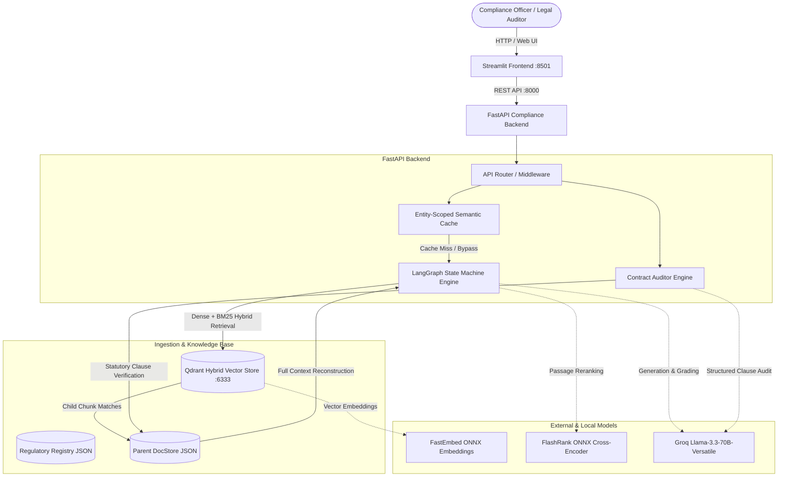

# ReguLens System Architecture

ReguLens is an Agentic Retrieval-Augmented Generation (RAG) platform and Automated Contract Auditing engine built specifically for regulatory compliance with Reserve Bank of India (RBI) Master Directions.

---

## 1. High-Level System Architecture

---

## 2. Core Architectural Principles

1. **Deterministic Regulatory Integrity & Provenance**:
   - Zero hallucination tolerance. Every factual assertion must link to an exact statutory quotation (10–25 continuous words) matching the indexed parent clause in the official regulatory circular.
   - Exact page numbers and circular citations are maintained from source PDF extraction through Docling/`pypdfium2` to final response.

2. **Dual-Space Hybrid Retrieval with Parent Document Expansion**:
   - Ingested circulars are indexed in Qdrant with dual named vector spaces:
     - `dense`: 384-dimensional dense vectors via FastEmbed `BAAI/bge-small-en-v1.5`.
     - `bm25`: sparse token vectors via FastEmbed `Qdrant/bm25`.
   - Child chunks (~400 characters) are queried with Reciprocal Rank Fusion ($k=60$) across dense and sparse spaces.
   - Child matches are mapped back to parent clauses (~1,500–2,500 characters) from the Parent DocStore, ensuring the LLM has complete legal context without boundary truncation.
   - Cross-Encoder reranking via FlashRank (`ms-marco-MiniLM-L-12-v2`) orders parent clauses by true semantic relevance.

3. **Temporal Regulatory Isolation & Versioning**:
   - Regulatory documents maintain lifecycle states (`ACTIVE`, `SUPERSEDED`, `REPEALED`).
   - By default, searches isolate `ACTIVE` regulations. Historical regulations (e.g., the repealed 2022 Digital Lending Guidelines) are strictly excluded unless `historical_mode=True` is explicitly specified by the auditor.

4. **Fail-Closed Contract Auditing**:
   - When evaluating fintech contract clauses against RBI statutory mandates, unrecognized or ambiguous clauses default to `REVIEW_REQUIRED` with status `INSUFFICIENT_EVIDENCE`.
   - The engine never silently reports a `PASS` without explicit statutory backing.

5. **Entity-Safe Semantic Caching**:
   - Queries are cached based on exact entity boundaries (Entity Guard). Cross-entity lookups (e.g., questions asking about "Bank XYZ" vs "Fintech ABC") never return contaminated cached answers.
   - Only responses with 100% verified citations are eligible for semantic cache entry.

6. **Decoupled Client-Server Topology**:
   - The Streamlit interface acts as a decoupled HTTP client communicating with the FastAPI backend over REST APIs.
   - If the backend is running in-process, seamless local fallbacks ensure zero disruption.

---

## 3. Technology Stack

| Layer | Component | Specification |
|---|---|---|
| **API & Routing** | FastAPI | Asynchronous REST API, OpenAPI 3.1, Pydantic v2 schemas |
| **User Interface** | Streamlit | Dual-tab compliance workstation (Query Explorer & Contract Auditor) |
| **Agent Framework** | LangGraph | StateGraph cyclic finite state machine with batch retrieval grading |
| **Vector Database** | Qdrant | Hybrid vector search (`dense` + `bm25` sparse vectors), local/cloud |
| **Embeddings** | FastEmbed | `BAAI/bge-small-en-v1.5` (Dense), `Qdrant/bm25` (Sparse) |
| **Reranker** | FlashRank | `ms-marco-MiniLM-L-12-v2` ONNX cross-encoder |
| **LLM Inference** | Groq / LangChain | `llama-3.3-70b-versatile` with temperature 0.0 and schema constraints |
| **Document Processing** | Docling & pypdfium2 | Layout-aware PDF/HTML conversion, table retention, provenance tracking |
| **Testing** | Pytest | 28 automated gate and regression tests |
