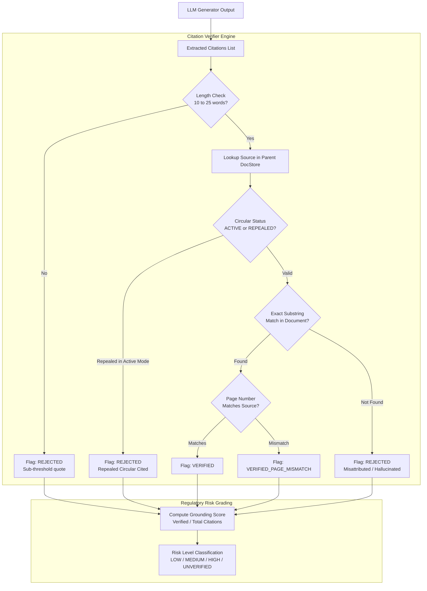

# Deterministic Citation Verification & Statutory Attribution

In regulatory technology and compliance auditing, a hallucinated citation or an invented regulatory clause can lead to catastrophic legal non-compliance, regulatory penalties, and erroneous contract approvals.

ReguLens implements a **Deterministic Substring Citation Verification Algorithm** that programmatically audits every citation emitted by the LLM before releasing the response.

---

## 1. Citation Verification Pipeline



---

## 2. Statutory Substring Matching Algorithm

Every citation emitted by the generator must contain:
1. `source_circular`: e.g., `"Reserve Bank of India (Digital Lending) Directions, 2025"`
2. `clause_number`: e.g., `"Clause 10.2"`
3. `page_number`: e.g., `6`
4. `exact_quote`: 10–25 continuous words quoted verbatim from the regulation.

### Step 1: Text Normalization
Both the claimed statutory quote and the underlying source text are normalized using `normalize_statutory_text()`:
- Converts curly quotes (`“`, `”`, `‘`, `’`) to standard ASCII quotes.
- Normalizes multiple whitespace characters, tabs, and line breaks to single spaces.
- Strips markdown formatting bolding (`**`), italics (`*`), and heading symbols (`#`).
- Normalizes statutory section symbols (`§`) and non-breaking spaces.

### Step 2: Continuous Word Length Guard
- Statutory quotes must be **at least 10 words** and **at most 25 words**.
- Quotes under 10 words are statistically ambiguous and susceptible to spurious matching (e.g., `"regulated entities shall"` or `"prior consent"` appears dozens of times).
- Sub-threshold quotes are flagged:
  ```json
  {
    "status": "REJECTED_SUB_THRESHOLD_QUOTE",
    "details": "Quote length (6 words) is below the mandatory 10-word statutory verification threshold."
  }
  ```

### Step 3: Source Isolation & Misattribution Detection
- The verification engine does not search across the entire corpus for a quote. Instead, it looks up the **specific document and parent clause claimed by the citation**.
- If a quote exists in the KYC Direction but the citation attributes it to the Digital Lending Directions, the engine flags it as **misattributed**:
  ```json
  {
    "status": "REJECTED_MISATTRIBUTED_QUOTE",
    "details": "Quote exists in RBI_KYC_2016 but was misattributed to RBI_DL_2025."
  }
  ```

### Step 4: Repealed Circular Isolation
- If a query operates in default `ACTIVE` mode and the generator cites a superseded or repealed document (such as `RBI_DL_2022`), the citation is rejected:
  ```json
  {
    "status": "REJECTED_REPEALED_SOURCE",
    "details": "Citation references RBI_DL_2022 which was formally repealed by RBI/2025-26/36."
  }
  ```

---

## 3. Grounding Score & Regulatory Risk Level

After auditing all citations in a response, ReguLens calculates the **Grounding Score**:

$$\text{Grounding Score} = \frac{N_{\text{verified}}}{N_{\text{total}}}$$

Based on this score and statutory severity, the response is categorized into a regulatory risk level:

| Grounding Score | Verified Citations | Assigned Risk Level | Cache Eligibility |
|---|---|---|---|
| $1.00$ (100%) | All citations verified | `LOW` | **Eligible** |
| $0.75 - 0.99$ | Majority verified | `MEDIUM` | Ineligible |
| $0.01 - 0.74$ | Minor verified / misattributions | `HIGH` | Ineligible |
| $0.00$ (0%) | Zero verified citations | `UNVERIFIED` | Ineligible |

Only responses with `risk_level == "LOW"` (100% verified citations) are permitted to enter the Semantic Cache. This guarantees that corrupted, incomplete, or ungrounded responses are never served to future users.
