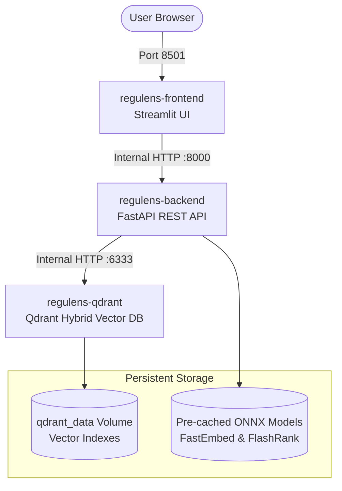

# Deployment & Production Operations Guide

ReguLens is architected for production deployment via Docker Compose or standalone bare-metal environments. It features pre-cached ONNX models, decoupled client-server microservices, and automated health checks.

---

## 1. Multi-Service Container Architecture



---

## 2. Docker Compose Deployment

### Services Configuration (`docker-compose.yml`)

1. **`qdrant`**: Official Qdrant vector database (`qdrant/qdrant:latest`) exposing REST (6333) and gRPC (6334) with persistent storage volume `qdrant_data`.
2. **`fastapi-backend`**: FastAPI REST API container running Uvicorn on port 8000.
3. **`streamlit-frontend`**: Streamlit compliance workstation on port 8501.

### Quick Start
To launch the complete platform:

```bash
# 1. Ensure your .env file is configured (see .env.example)
cp .env.example .env

# 2. Build and launch all three microservices
docker compose up --build
```

Access the user interfaces:
- **Streamlit Dual-Tab Workstation**: `http://localhost:8501`
- **FastAPI Interactive Swagger Docs**: `http://localhost:8000/docs`
- **Qdrant Vector Web Dashboard**: `http://localhost:6333/dashboard`

---

## 3. Resolving the Streamlit `ModuleNotFoundError: No module named 'src'`

### Root Cause of Legacy Container Error
In the initial prototype, `streamlit-frontend` attempted to directly import Python modules from `src/` inside an isolated container environment where `PYTHONPATH` was not mounted or where `src` was not copied into the runtime image. This produced the fatal runtime crash:
`ModuleNotFoundError: No module named 'src'` at `/app/frontend/app.py`.

### Architectural Resolution
1. **Microservice Decoupling**:
   - `frontend/app.py` was refactored into a pure HTTP client that queries the backend via REST endpoints (`http://fastapi-backend:8000/api/v1/query`, `/api/v1/audit`, `/api/v1/metrics`).
   - The frontend no longer requires direct Python imports of internal retrieval or LLM graph modules.
2. **Path Hardening**:
   - Defensive path resolution was added to `frontend/app.py`:
     ```python
     ROOT_DIR = Path(__file__).resolve().parent.parent
     if str(ROOT_DIR) not in sys.path:
         sys.path.insert(0, str(ROOT_DIR))
     ```
3. **Docker Environment Injection**:
   - Explicit `PYTHONPATH=/app` and `FASTAPI_URL=http://fastapi-backend:8000` were configured in `docker-compose.yml`.

---

## 4. Multi-Stage Dockerfile with Model Pre-Caching

Regulatory compliance engines cannot tolerate download delays or network timeouts when scaling new container replicas.

The `Dockerfile` pre-caches all embedding and cross-encoder ONNX weights during the container build stage:

```dockerfile
# Pre-cache ONNX embedding & reranker model weights during build
ENV HF_HUB_ENABLE_HF_TRANSFER=0
RUN python -c "\
from fastembed import TextEmbedding, SparseTextEmbedding;\
from flashrank import Ranker;\
TextEmbedding(model_name='BAAI/bge-small-en-v1.5');\
SparseTextEmbedding(model_name='Qdrant/bm25');\
Ranker(model_name='ms-marco-MiniLM-L-12-v2', cache_dir='/app/.model_cache');\
print('Pre-cached all ONNX model weights successfully!')\
"
```

This guarantees:
- **Instant Container Boot**: Zero model downloading occurs when the container starts.
- **Air-Gapped & Offline Ready**: Container images can be deployed in secure financial private VPCs without internet access to Hugging Face.

---

## 5. Local Bare-Metal Execution (Without Docker)

To run the application locally on your workstation using the virtual environment:

### Terminal 1 — Start FastAPI Backend:
```bash
.\.venv\Scripts\Activate.ps1
uvicorn src.api.main:app --host 0.0.0.0 --port 8000 --reload
```

### Terminal 2 — Start Streamlit Frontend:
```bash
.\.venv\Scripts\Activate.ps1
streamlit run frontend/app.py --server.port 8501
```

---

## 6. Health Checks & Monitoring Endpoints

| Endpoint | Method | Purpose | SLA |
|---|---|---|---|
| `/health` | `GET` | Container liveness check | < 10ms |
| `/ready` | `GET` | Readiness check (validates Qdrant connectivity and docstore) | < 50ms |
| `/api/v1/health` | `GET` | API v1 liveness | < 10ms |
| `/api/v1/metrics` | `GET` | Cache hit ratio, total queries, latency breakdown telemetry | < 15ms |
