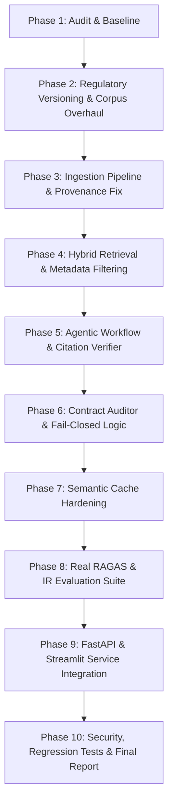

# 🔍 ReguLens Engineering Audit & Architectural Assessment

**Audit Execution Date:** November 12, 2026  
**Auditor Roles:** Senior AI/ML Engineer, Agentic RAG Architect, Backend/Security Engineer, Regulatory Tech Specialist  
**Repository:** [regulens-agentic-rag-compliance-engine](https://github.com/sdkrmehta/regulens-agentic-rag-compliance-engine)  
**Target Environment:** Python 3.11, Qdrant Hybrid (Dense + Sparse BM25), Groq Cloud LLMs (Llama 3.1 8B / 3.3 70B), FastAPI, Streamlit, Docker

---

## 1. Executive Summary

This comprehensive audit was conducted to rigorously assess the architecture, regulatory fidelity, data pipelines, retrieval mechanics, agent state graphs, verification logic, caching rules, and production deployment readiness of **ReguLens**.

While ReguLens demonstrates a functional prototype architecture featuring two-tier chunking, hybrid vector retrieval, and LangGraph orchestration, deep source-level auditing has uncovered **critical architectural, regulatory, and data-integrity deficiencies** that prevent it from operating as a defensible, production-grade regulatory compliance platform.

### High-Level Audit Findings Matrix

| Dimension | Initial State | Severity | Key Finding |
| :--- | :---: | :---: | :--- |
| **Regulatory Currency** | Critical Defect | 🔴 CRITICAL | Active corpus uses repealed **2022 Digital Lending Guidelines** (`RBI/2022-23/111`), unaware of the superseding **RBI (Digital Lending) Directions, 2025** (`RBI/2025-26/36`). |
| **Document Ingestion** | Partially Functional | 🔴 CRITICAL | Fake page boundaries injected every fixed 2,200 characters in HTML conversion; Docling parser exists as dead code bypassed by scripts. |
| **Citation Verification** | Inadequate Verification | 🔴 CRITICAL | Only checks if a quote exists in *any* retrieved parent, not checking exact cited document, clause, or page provenance. Fallback generator fabricates quotes from top documents. |
| **Contract Auditor** | Fail-Open Vulnerability | 🔴 CRITICAL | Default fallback returns `compliance_status="PASS"` when no hardcoded rule triggers, creating catastrophic false-negative compliance risks. |
| **Semantic Caching** | Cache Contamination | 🟠 HIGH | Responses with zero citations bypass verified citation check; missing regulatory category scoping in cache keys. |
| **Evaluation & Metrics** | Methodological Inaccuracy | 🔴 CRITICAL | `eval/run_ragas.py` calculates custom unigram word overlap and labels it "RAGAS". Real RAGAS metrics and IR benchmarks (MRR, nDCG) are absent. |
| **API & Frontend** | Decoupled Architecture | 🟡 MEDIUM | Streamlit runs duplicate in-process LangGraph agent rather than communicating over `FASTAPI_URL`. Telemetry metrics in UI are hardcoded. |
| **Deployment & Config** | Fragile Orchestration | 🟡 MEDIUM | Initial Docker setup failed due to missing `curl` in Qdrant base image and host volume permissions. |

---

## 2. Existing Architecture & Data Flow

### Ingestion Path
1. Raw HTML gazette copies (`kyc_html.html`, `dl_html.html`, `cyb_html.html`) were saved locally.
2. `src/ingestion/html_to_markdown.py` parsed HTML using BeautifulSoup, stripping superscripts and inserting artificial `<!-- PAGE_NUMBER: n -->` markers every 2,200 characters.
3. `src/ingestion/chunker.py` split Markdown on headers (`MarkdownHeaderTextSplitter`), capped parents at 1,500 tokens, and generated 256-token child chunks with Markdown table header injection.
4. `src/retrieval/vector_store.py` indexed child chunks into Qdrant collection `rbi_compliance_hybrid` with dense (`BAAI/bge-small-en-v1.5`) and sparse (`Qdrant/bm25`) vectors.

### Query Runtime Path
1. User question submitted via Streamlit or `/ask` endpoint.
2. `EntityScopedSemanticCache` checked vector cosine similarity against cached questions.
3. If uncached, LangGraph state graph triggered:
   - `router_node` (Llama-3.1-8B) classified query intent.
   - `retrieve_node` fetched top 15 candidates via Qdrant RRF, resolved parents, and reranked to top 4 using FlashRank (`ms-marco-MiniLM-L-12-v2`).
   - `grader_node` batch-graded 4 parents. If 0 relevant, routed to `rewriter_node` (up to 2 retries).
   - `generator_node` synthesized answer and citations via Llama-3.3-70B.
   - `verify_citation_quote` checked normalized quote substring against parent texts.
   - Cache store wrote response if verified.

---

## 3. Detailed Audit Findings by Subsystem

### 3.1 Regulatory Knowledge Base & Document Currency
- **Repealed Circular Active in Corpus:** `data/processed_md/rbi_digital_lending_guidelines.md` is based on Circular `RBI/2022-23/111` (September 02, 2022). The header of the official gazette explicitly states: *"The Circular has been repealed. Please refer to Reserve Bank of India (Digital Lending) Directions, 2025 dated May 8, 2025 (RBI/2025-26/36)"*.
- **Lack of Version Metadata:** Regulatory documents have no machine-readable tracking for `effective_date`, `superseded_date`, `status` (ACTIVE, AMENDED, SUPERSEDED, REPEALED), or `regulated_entity_types`.
- **Hardcoded Obsolete Assumptions:** Contract auditor and evaluation questions rely on the repealed 2022 text without acknowledging 2025 updates (e.g. DLG 5% caps, CIMS DLA public directory, and multi-lender transparent views).

### 3.2 Document Ingestion & Provenance
- **Docling Disconnection:** `src/ingestion/parser.py` implements an IBM Docling parser, but it is not utilized in the indexing scripts (`scripts/reindex_all.py` exclusively calls `html_to_markdown.py`).
- **Simulated Page Numbers:** In `src/ingestion/html_to_markdown.py`, `chars_per_page = 2200` blindly increments page numbers every 2,200 characters. For HTML gazette sources, this creates pseudo-page citations that have no correspondence to official gazette gazetted PDF page numbers.
- **Non-Atomic Indexing:** Reindexing drops and recreates the active collection (`store.init_collection(recreate=True)`), resulting in total downtime and data loss if indexing fails mid-process.

### 3.3 Hybrid Retrieval Engine
- **Limited Metadata Filtering:** `RBIHybridVectorStore.hybrid_search()` only filters on `doc_category`. Filters for `regulator`, `regulated_entity_types`, `document_status`, and `effective_date` are completely absent.
- **Sparse BM25 Query Configuration:** Lexical search is performed using fastembed `SparseTextEmbedding("Qdrant/bm25")` and Qdrant RRF fusion, but does not provide exact clause matching boosts for structured statutory identifiers (e.g., "Clause 38", "Section 10.1").

### 3.4 Agentic Workflow & Citation Verification
- **Permissive Substring Verification:** In `src/agent/verifier.py`, `verify_citation_quote` checks if `verbatim_quote` appears in *any* graded parent in the state, rather than verifying it against the specific document, section, and page cited.
- **Minimum Word Constraint Gap:** The schema specifies 10–25 word verbatim quotes, but `verifier.py` allowed quotes as short as 4 words (`len(norm_quote.split()) < 4`).
- **Fabricated Fallback Quotations:** In `src/agent/nodes.py` (lines 228–249), if the 70B model call fails or credentials are missing, the generator generates a fallback response by slicing the first 15 words of `top_doc` and declaring it a verified citation.
- **Unverified Answer Passthrough:** If an LLM response contains citations that fail verification (`cit.verified = False`), the generator still returns the answer to the user without adjusting the risk level or indicating insufficient evidence.

### 3.5 Contract Compliance Auditor
- **Fail-Open Default:** In `src/agent/auditor.py`, obligations that do not match the three hardcoded keyword filters fall back to `compliance_status="PASS"`. Unrecognized or novel non-compliant clauses are marked compliant by default.
- **Binary Status Structure:** Only supports `PASS`, `FAIL`, and `WARNING`. Lacks defensible compliance statuses: `COMPLIANT`, `NON_COMPLIANT`, `PARTIALLY_COMPLIANT`, `REVIEW_REQUIRED`, `INSUFFICIENT_EVIDENCE`.
- **Scattered Rules:** Hardcoded if-statements are embedded in Python functions rather than driven by a versioned regulatory obligation registry.

### 3.6 Semantic Caching
- **Empty Citation Leak:** `store_cache()` checks `if not has_verified_citation and response.citations: return False`. If `response.citations == []`, this condition evaluates to `False`, allowing unverified or uncited answers to be cached as verified!
- **Missing Category Isolation:** Cache keys are solely based on question text and extracted entities, without scoping to regulatory category or corpus version, allowing potential cross-domain collisions.

### 3.7 Evaluation & Benchmarking
- **Pseudo-RAGAS Implementation:** `eval/run_ragas.py` claims to compute Ragas metrics, but actually computes unigram token intersection formulas (`calculate_token_overlap_metrics`).
- **Discrepancy in Published Numbers:** `eval/benchmark_results.csv` reports Faithfulness scores between 0.60 and 0.94, while `README.md` claimed an aggregate 0.96 Faithfulness.
- **Lack of IR Metrics:** Standard IR metrics (Recall@K, Precision@K, MRR, nDCG@K) are not implemented.

### 3.8 Backend, Frontend & Deployment
- **Decoupled Streamlit Client:** `frontend/app.py` loads its own in-process `RBIHybridVectorStore` and `compliance_agent` instead of calling FastAPI via `FASTAPI_URL`.
- **Hardcoded Dashboard Metrics:** Streamlit sidebar displays hardcoded `"561"` indexed chunks and static metrics.
- **Synchronous Event Loop Blocking:** FastAPI endpoints run synchronous vector searches and LLM calls directly on the async event loop without `asyncio.to_thread` or thread pools.

---

## 4. Remediation Plan & Engineering Roadmap

### Action Items:
1. **Regulatory Corpus:** Add metadata registry (`src/schemas.py` & `data/regulatory_registry.json`), update to active 2025 Digital Lending Directions while maintaining historical 2022 guidelines with `SUPERSEDED` status.
2. **Ingestion & Provenance:** Rebuild ingestion to support real Docling/pypdfium2 extraction, remove 2,200-char fake page injection, preserve clause anchors, and implement safe atomic blue/green Qdrant indexing.
3. **Retrieval:** Add metadata filtering (`status`, `category`, `entity_type`, `effective_date`) across dense and sparse prefetch.
4. **Agent & Verifier:** Strict source-specific 10–25 word citation verification; eliminate fabricated fallback citations; enforce fail-closed status transitions.
5. **Auditor:** Rebuild around a versioned `RegulatoryObligationRegistry` with `COMPLIANT`, `NON_COMPLIANT`, `PARTIALLY_COMPLIANT`, `REVIEW_REQUIRED`, `INSUFFICIENT_EVIDENCE`.
6. **Cache:** Prevent empty-citation cache leaks; enforce regulatory category and corpus version scoping in cache keys.
7. **Evaluation:** Implement true RAGAS evaluations and formal IR ranking metrics (Recall@K, MRR, nDCG).
8. **FastAPI & UI:** Thread-offload blocking calls in FastAPI; refactor Streamlit to consume `/api/v1/*` REST endpoints with dynamic telemetry.
9. **Regression Tests:** Write isolated unit and regression tests covering all 16 failure scenarios identified in Part 14.3.
