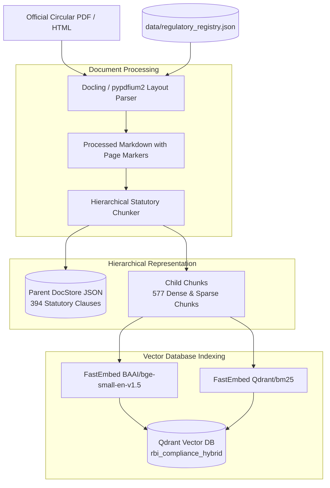

# Ingestion Pipeline & Knowledge Base Architecture

The ReguLens ingestion pipeline processes raw regulatory circulars and Master Directions from the Reserve Bank of India into structured, provenance-anchored chunks indexed in a hybrid vector database.

---

## 1. Regulatory Registry & Ingestion Workflow



---

## 2. Regulatory Knowledge Base Corpus

ReguLens ingests and indexes the following official RBI regulatory documents:

| Circular Code | Document Title | Status | Circular Number | Effective Date |
|---|---|---|---|---|
| `RBI_DL_2025` | **Reserve Bank of India (Digital Lending) Directions, 2025** | `ACTIVE` | `RBI/2025-26/36` (DOR.CRE.REC.36/21.07.001/2025-26) | May 8, 2025 |
| `RBI_DL_2022` | *Guidelines on Digital Lending (Repealed/Superseded)* | `SUPERSEDED` | `RBI/2022-23/111` (DOR.CRE.REC.66/21.07.001/2022-23) | Sept 2, 2022 |
| `RBI_KYC_2016` | **Master Direction – Know Your Customer (KYC) Direction, 2016** (Updated 2024) | `ACTIVE` | `RBI/DBR/2015-16/18` (DBR.AML.BC.No.81/14.01.001/2015-16) | Feb 25, 2016 |
| `RBI_CYBER_2024`| **Master Direction on Cyber Resilience and Digital Payment Security Controls** | `ACTIVE` | `RBI/2024-25/54` (DOS.CO.CSITE.SEC.No.54/31.01.015/2024-25) | July 30, 2024 |

### Regulatory Currency & Repeal Handling
The **Reserve Bank of India (Digital Lending) Directions, 2025** explicitly repealed the earlier 2022 Digital Lending Guidelines. To ensure compliance safety:
- All 2025 clauses are tagged `document_status = "ACTIVE"`.
- All 2022 clauses are tagged `document_status = "SUPERSEDED"`.
- Production queries default to active regulations only, isolating historical clauses unless explicitly requested.

---

## 3. High-Fidelity Parsing & Elimination of Artificial Page Splitting

### Issue with Legacy Ingestion
The original prototype split documents into artificial pages by dividing text length by 2,200 characters (`page_number = (idx // 2200) + 1`). This fabricated page citations that did not correspond to physical regulatory pages.

### Production Solution
1. **Docling TableFormer Engine**:
   - Parses complex PDF layout structures, multi-column tables, and schedules.
   - Converts Markdown tables into standard GitHub-flavored Markdown without row or column truncation.
2. **`pypdfium2` True Page Geometry**:
   - Extracts text and coordinate bounding boxes page-by-page.
   - Injects explicit statutory page boundary markers (`<!-- PAGE_BREAK: N -->`).
3. **HTML Sanitization**:
   - Parses official RBI web notifications, strips navigation headers, footers, and scripts, while preserving headers (`#`, `##`, `###`), list hierarchies, and tables.

---

## 4. Hierarchical Parent-Child Chunking

Legal regulations contain complex internal dependencies. Splitting text into arbitrary 300-word segments cuts sentences in half and loses definitions. ReguLens utilizes a two-tier **Parent-Child Chunking Strategy**:

### Parent Clause Tier (Context Preservation)
- Boundary-aligned to statutory sections, chapters, and numbered clauses (e.g., `Clause 10. Collection, Usage and Sharing of Borrower Data`).
- Preserves full statutory text (typically 1,200 to 2,500 characters) along with complete tables.
- Stored in `data/parent_docstore.json` with comprehensive provenance:
  ```json
  {
    "parent_id": "RBI_DL_2025_S0012",
    "document_id": "RBI_DL_2025",
    "circular_name": "Reserve Bank of India (Digital Lending) Directions, 2025",
    "circular_number": "RBI/2025-26/36",
    "doc_category": "DIGITAL_LENDING",
    "section_clause": "Clause 10. Collection, Usage and Sharing of Borrower Data",
    "page_number": 6,
    "document_status": "ACTIVE",
    "has_table": false,
    "text": "## Chapter III: Technology and Data Requirements..."
  }
  ```

### Child Chunk Tier (Embedding & Matching)
- Parent clauses are segmented into overlapping child chunks of ~400 characters (with 50 character overlap).
- Embedded into both dense and sparse vector spaces.
- Each child chunk stores a reference back to its `parent_id`.
- Retrieval hits on child chunks are mapped back to their parent clause before passing to the LLM, ensuring zero truncated sentences.

---

## 5. Qdrant Hybrid Collection Indexing

The Qdrant collection `rbi_compliance_hybrid` is created with dual named vector spaces:

```python
client.create_collection(
    collection_name="rbi_compliance_hybrid",
    vectors_config={
        "dense": models.VectorParams(size=384, distance=models.Distance.COSINE)
    },
    sparse_vectors_config={
        "bm25": models.SparseVectorParams(modifier=models.Modifier.IDF)
    }
)
```

Payload indexing is configured on:
- `document_id` (Keyword)
- `doc_category` (Keyword)
- `document_status` (Keyword: `ACTIVE`, `SUPERSEDED`, `REPEALED`)
- `parent_id` (Keyword)
- `page_number` (Integer)

### Indexing Script
To rebuild the corpus:
```bash
python scripts/index_corpus.py
```
This processes all Markdown files in `data/processed_md/`, generates `data/parent_docstore.json` (394 parent clauses), and indexes 577 child vectors in Qdrant.
