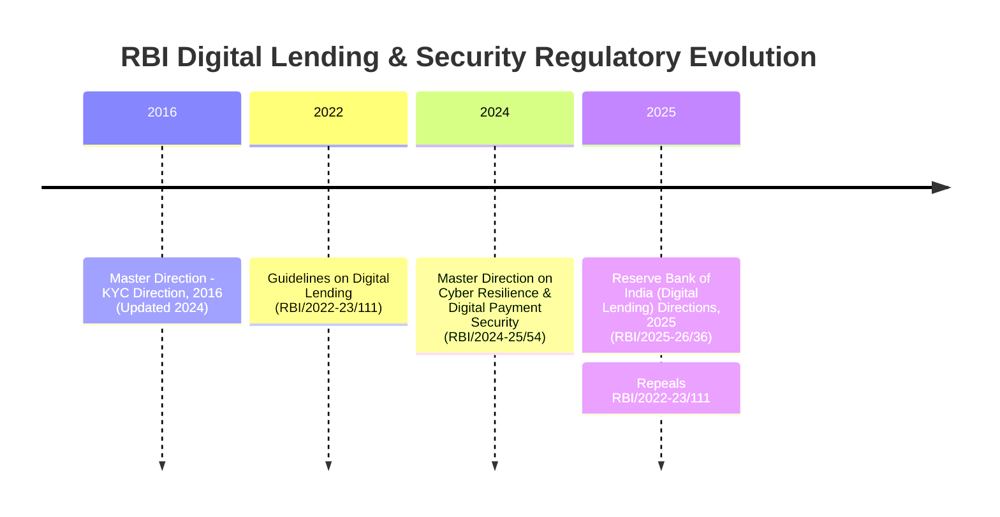

# Regulatory Versioning, Temporal Isolation & Currency

Financial regulations evolve constantly. In regulatory technology, serving repealed regulatory provisions as active statutory mandates is a critical compliance hazard.

ReguLens implements a strict **Temporal Isolation and Versioning Engine** that differentiates active law from historical regulations.

---

## 1. Regulatory Timeline & Circular Hierarchy



---

## 2. Active Directions vs. Repealed Guidelines

### The 2025 Digital Lending Directions (`RBI_DL_2025`)
On **May 8, 2025**, the Reserve Bank of India issued the **Reserve Bank of India (Digital Lending) Directions, 2025** (`RBI/2025-26/36`, Notification No. `DOR.CRE.REC.36/21.07.001/2025-26`).

This Master Direction formally repealed the earlier **Guidelines on Digital Lending** issued on September 02, 2022 (`RBI/2022-23/111`).

Key differences and additions in the 2025 Directions include:
1. **Mandatory CIMS Public Directory (Clause 12)**:
   - Regulated Entities (REs) must report all active Digital Lending Apps (DLAs) operated by the RE or its Lending Service Providers (LSPs) to the RBI's Centralised Information Management System (CIMS).
   - REs must publish and continuously update the verified list of DLAs on their public website with authorized download links.
2. **Stricter Mobile Resource Prohibition (Clause 10.2)**:
   - Re-affirms and deepens explicit prohibitions against accessing mobile phone resources, contact lists, media storage, call logs, and telephony functions.
   - Restricts one-time permissions strictly to camera/microphone/location solely for onboarding/V-CIP verification.
3. **Standardized Key Fact Statement (KFS) & Cooling-Off Period (Clauses 6 & 8)**:
   - Standardized KFS disclosure including all inclusive APR calculations.
   - Mandatory cooling-off period of at least 3 days for loans with tenor $\ge 7$ days (1 day for shorter tenor) without prepayment penalties.
4. **Default Loss Guarantee (DLG / FLDG) Cap (Clause 13)**:
   - Strict 5% portfolio cap on Default Loss Guarantee arrangements with LSPs.

---

## 3. Regulatory Registry (`data/regulatory_registry.json`)

All documents in ReguLens are governed by the central regulatory registry:

```json
{
  "RBI_DL_2025": {
    "circular_name": "Reserve Bank of India (Digital Lending) Directions, 2025",
    "circular_number": "RBI/2025-26/36",
    "notification_number": "DOR.CRE.REC.36/21.07.001/2025-26",
    "effective_date": "2025-05-08",
    "document_status": "ACTIVE",
    "doc_category": "DIGITAL_LENDING",
    "repeals": ["RBI_DL_2022"],
    "description": "Comprehensive Master Direction governing digital lending operations, DLAs, LSPs, and data privacy."
  },
  "RBI_DL_2022": {
    "circular_name": "Guidelines on Digital Lending",
    "circular_number": "RBI/2022-23/111",
    "notification_number": "DOR.CRE.REC.66/21.07.001/2022-23",
    "effective_date": "2022-09-02",
    "document_status": "SUPERSEDED",
    "doc_category": "DIGITAL_LENDING",
    "superseded_by": "RBI_DL_2025",
    "description": "Historical guidelines issued in 2022. Formally repealed and superseded by RBI/2025-26/36."
  }
}
```

---

## 4. Operational Modes: Active vs. Historical

ReguLens supports two operational modes:

### 1. Active Mode (Default)
- **Use Case**: Day-to-day compliance advising, current contract audits, live fintech integration checks.
- **Filtering Behavior**:
  - Automatically injects Qdrant payload filter `document_status == "ACTIVE"`.
  - Excludes all chunks tagged `SUPERSEDED` or `REPEALED`.
  - Any citation referencing a repealed circular is immediately flagged and rejected by the verifier.

### 2. Historical Mode (`historical_mode=True`)
- **Use Case**: Retrospective audits, forensic legal reviews, evaluating historical loan agreements executed between September 2022 and May 2025.
- **Filtering Behavior**:
  - Relaxes the active filter, allowing point-in-time analysis of repealed circulars while explicitly tagging the historical provenance in audit findings.
