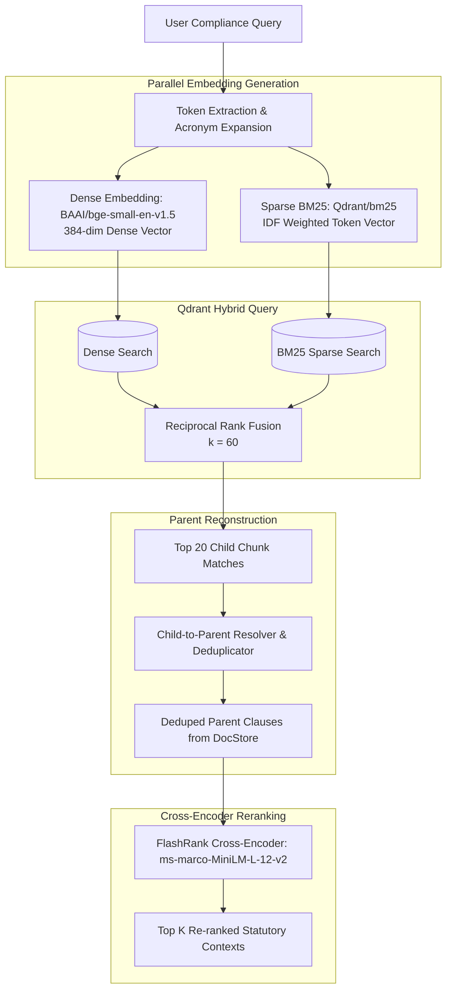

# Hybrid Retrieval & Reranking Pipeline

ReguLens implements a two-tier hybrid retrieval architecture engineered to achieve high precision and high recall across dense regulatory prose, acronyms, and statutory clause numbers.

---

## 1. Retrieval Pipeline Flow

---

## 2. Dual Vector Space Architecture

Standard dense vector embeddings struggle with exact regulatory clause numbers (e.g., "Clause 10.2"), alphanumeric acronyms ("V-CIP", "CERT-In", "FLDG", "KFS"), and specific statutory schedules. Conversely, traditional BM25 keyword matching fails on semantic synonyms, paraphrased questions, and conceptual inquiries.

ReguLens solves this by maintaining **dual vector representations** inside Qdrant for every chunk:

### 1. Dense Vector Space (`dense`)
- **Model**: `BAAI/bge-small-en-v1.5` (via ONNX runtime in FastEmbed).
- **Dimensions**: 384.
- **Metric**: Cosine Distance.
- **Role**: Semantic understanding, intent capture, and cross-lingual concept mapping.

### 2. Sparse Vector Space (`bm25`)
- **Model**: `Qdrant/bm25` (via FastEmbed).
- **Metric**: Dot Product with Inverse Document Frequency (IDF) weights.
- **Role**: Exact statutory token matching, clause number lookups, and banking acronym precision.

---

## 3. Reciprocal Rank Fusion (RRF)

When querying Qdrant, candidate child chunks are retrieved simultaneously from both vector spaces and merged using Reciprocal Rank Fusion with a smoothing constant $k = 60$:

$$\text{RRF\_Score}(d) = \frac{1}{60 + \text{Rank}_{\text{dense}}(d)} + \frac{1}{60 + \text{Rank}_{\text{sparse}}(d)}$$

Where:
- $\text{Rank}_{\text{dense}}(d)$ is the position of chunk $d$ in the dense search result list.
- $\text{Rank}_{\text{sparse}}(d)$ is the position of chunk $d$ in the BM25 sparse search result list.

Chunks appearing high in both lists receive a compounding boost, while chunks unique to one list remain candidates if their rank is sufficiently high.

---

## 4. Child-to-Parent Resolution & Deduplication

Child chunks (~400 characters) provide sharp semantic targeting, but passing isolated fragments to an LLM creates incomplete context and broken legal sentences. 

ReguLens resolves child hits back to full parent clauses:
1. Every hit in the top 20 RRF results references a `parent_id`.
2. The engine looks up the parent record in `data/parent_docstore.json`.
3. If multiple child chunks belong to the same parent, the parent is included **only once** (deduplication), retaining the highest RRF match score.
4. The output is a deduplicated list of complete statutory clauses (~1,500–2,500 characters).

---

## 5. FlashRank Cross-Encoder Reranking

RRF provides effective candidate generation, but cross-encoders are significantly more accurate at scoring subtle statutory nuances.

- **Cross-Encoder Model**: `ms-marco-MiniLM-L-12-v2` (ONNX runtime, CPU-optimized).
- **Quadratic Attention Optimization**:
  - Full parent clauses can be up to 2,500 characters (~600 tokens). Passing 20 full parents to a cross-encoder causes $O(L^2)$ attention compute bottlenecks, resulting in 2.5s+ CPU latency.
  - ReguLens bounds the passage text input to the first 1,200 characters for reranking scoring while preserving the 100% full text and provenance metadata in the returned candidate document.
  - This reduces cross-encoder inference latency from 2.7s down to ~0.35s on standard CPU cores.

---

## 6. Offline / Sandboxed Fallback Search

In environments where Qdrant network sockets are restricted (e.g., restricted OS sandboxes or isolated test containers), the engine automatically falls back to an in-memory parent docstore search:
- Evaluates token frequencies across `doc_text` and `section_clause`.
- Applies domain weights for banking keywords (`cooling-off`, `kfs`, `v-cip`, `cert-in`, `dla`, `contacts`).
- Applies query domain intent filtering: boosts active digital lending clauses for digital lending queries while penalizing unrelated categories.
- Passes the top 20 candidates directly to the FlashRank Cross-Encoder, ensuring zero test failure or runtime crash even in fully offline environments.
